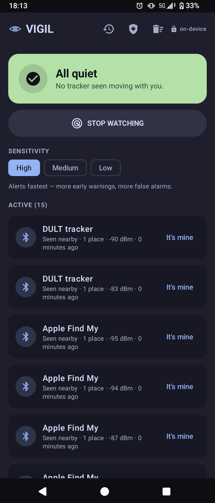
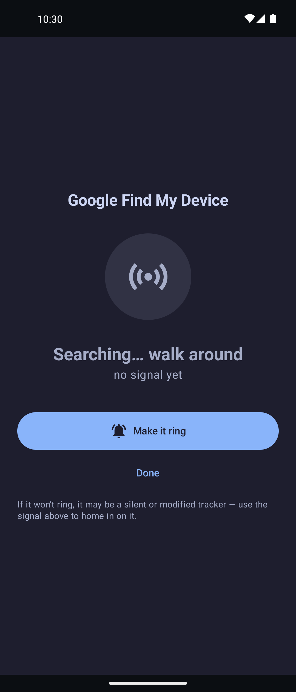
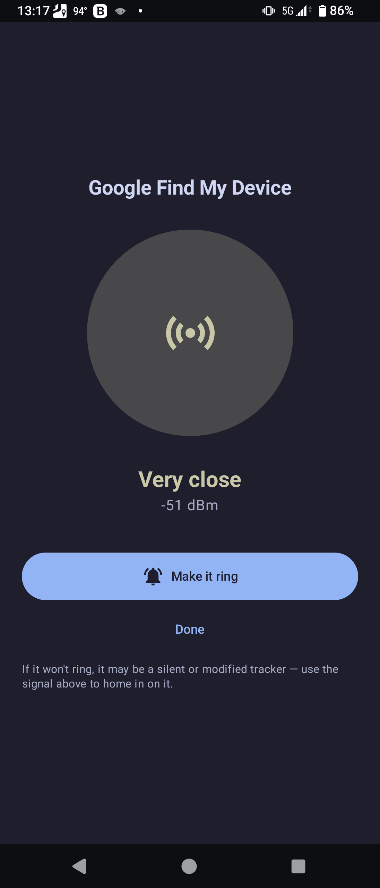

<div align="center">


# VIGIL

**What's been following you?**

</div>

A native Android (Kotlin) app that watches for personal item-trackers — Apple
AirTags, Tile, Samsung Galaxy SmartTags, and Google Find My Device / DULT tags —
that are **travelling with you over time**. It is the temporal counterpart to
[OVERWATCH](https://github.com/KaraZajac/OVERWATCH):

> **OVERWATCH is spatial** — *what surveillance is watching this place, right now.*
> **VIGIL is temporal** — *what has been with me, across time and places.*

A tracker being *near* you means nothing — trackers are everywhere. The signal is
**persistence**: the same device seen at many of *your* distinct locations, over a
sustained window. VIGIL is built around that idea.

> ⚠️ **Prototype / work in progress.** The scanning, parsing, temporal store,
> co-movement engine, allowlist, and learned baseline are in place; the app builds
> in CI. Wire-format offsets come from published reverse-engineering (see the
> [paper](paper/vigil.md), §3); they and the detection thresholds need validation
> against real hardware (see [Status](#status)).

---

## Screenshots

<p align="center">
  
  &nbsp;
  
  &nbsp;
  
</p>

<p align="center"><sub>The watch list &nbsp;·&nbsp; the hot/cold finder searching &nbsp;·&nbsp; homing in on a tracker, with “Make it ring”</sub></p>

<p align="center"><sub>Screenshots are from an earlier build. The current app words some screens differently, and its header adds History and Safety buttons.</sub></p>

## Privacy first — fully offline

VIGIL requests **no `INTERNET` permission at all.** There is no server, no account,
no telemetry. Every tracker, every sighting, and the entire learned baseline live
in an on-device SQLite database. VIGIL never transmits them and cloud backup is
off; they leave the phone only if you export an evidence report yourself.
**Detection listens to what trackers already broadcast and never connects to
them.** The one exception is the user-initiated **"Make it ring"** action, which
connects to a tracker you already suspect and asks it to play a sound (the
DULT-standard way for a victim to locate a hidden tag). Your phone's Bluetooth
scan can send generic scan requests, as any scan does, but VIGIL sends no data
anywhere.

---

## What it detects

Four native BLE wire formats today, plus the emerging unified DULT format. VIGIL
recognises each ecosystem and, where the ecosystem signals it, filters to the
**separated-from-owner** state — the only state in which a following tracker is
detectable (see the paper, §2.1). VIGIL takes that flag on trust, so a modified
tag that always claims its owner is nearby is never escalated. Tile has no such
flag, so every Tile is checked.

| Ecosystem | BLE signature | Separated-state signal | Passive re-link window |
|---|---|---|---|
| **Apple Find My / AirTag** | mfg data, company `0x004C`, type `0x12` | status byte "maintained" bit cleared | ~24 h (key static per day) |
| **Google Find My Device** | service data `0xFEAA`, frame `0x40`/`0x41` | frame `0x41` = separated (cleartext) | ~24 h once separated |
| **Samsung Galaxy SmartTag** | service data `0xFD5A` | state byte (lost / overmature-lost) | ~24 h once overmature |
| **Tile** | service data `0xFEED` / `0xFEEC` / `0xFE84` | none — static MAC, always findable | indefinite (static MAC) |
| **DULT (unified, emerging)** | service data `0xFCB2` | near-owner bit (byte 14 LSB) | ~24 h separated |

Chipolo, Pebblebee, eufy, Motorola, etc. inherit the signature of whichever
network (Apple or Google) their SKU joined — VIGIL detects the **network**.

## How it decides

Each parsed sighting is geotagged with a coarse fix and written to the temporal
store, and each tracker's last 24 hours are judged. Once VIGIL has seen it
separated from its owner (a Tile always counts), a tracker becomes `SUSPICIOUS`
with three spaced sightings and a peak that passed the RSSI gate, and `ALERTING` —
the only state that notifies — when it clears the full **co-movement test**:

- **≥ 3 sightings** (debounced to one per 15 min), across
- **≥ N distinct places** (geohash-7 cells; N = 2/3/4 by sensitivity), over
- **≥ T minutes** (30/45/90 by sensitivity), **and**
- an **RSSI proximity gate** — its peak signal must have reached −85 dBm at
  least once at the default setting (−90/−80 on High/Low). AirGuard has no such
  check, but it's a coarse one: a tag can clear it from tens of metres away. What
  stops "a Tile in the next car at a few red lights" is the debounce above. Each
  tag counts once per 15 minutes, so a short stretch side by side never adds up.

VIGIL needs location on: without a current fix it can't count places or
movement, so neither detector can alert.

Two trust signals suppress false alarms:

- **Allowlist ("This is mine").** Tap a tracker to mark it approved — your own
  AirTag, your partner's Tile — and VIGIL stops alerting on that identity. Tiles
  keep one identity; other tags change theirs at least daily and can come back as
  a new device.
- **Learned offline baseline.** VIGIL learns the places you spend time (home,
  work) as *anchors*. A tracker seen at an anchor on three different days, without
  moving with you, is auto-marked **Known (usual places)**, entirely on-device. In
  practice that's Tiles, the only tags that keep one identity for days; other
  household tags stay quiet because they don't travel with you, or report being
  near their owner.

## Finding a tracker

Tap any tracker for two ways to physically locate it:
- **Make it ring** — connects over GATT, asks the tracker to play its own sound,
  and reports what it answered: only a success reply counts as ringing, and a
  refusal (which a tag near its owner must send) shows as a refusal. An AirTag
  sends no reply, so VIGIL reports its command as accepted, and takes the AirTag
  hanging up as the sign it played its sound — by then the sound may be over.
  Supported: AirTags (native `0xAF` command), Google Find My Device and DULT tags
  (Chipolo, Pebblebee, eufy, Motorola), and Apple Find My accessories. Samsung
  SmartTag and Tile expose no non-owner ring, so VIGIL points you to the
  SmartThings / Tile app instead.
- **Hot/cold finder** — a passive proximity meter that turns live signal strength into
  a warmer/colder readout. It still works on **silent or modified tags that refuse to
  ring**, which is exactly when you need it most.

## The hard part — catching clones (problem #1)

Every shipping detector (AirGuard, iOS, Android's built-in) keys on **device
identity**. A key-rotating clone (e.g. Positive Security's *Find You*: ~2,000
Find My keys, a new one every 30 s) looks like 2,000 one-off devices to every one
of them. In Positive Security's 2022 test it tracked a phone for five days
with zero alerts, and AirGuard's manual scan showed only a stream of one-off
devices.

VIGIL's headline goal is to detect the **attack, not the device**: a rotating
clone is one physical radio holding an unbroken, close-range, co-moving RF
*presence* even as its identity churns thousands of times faster than any
standards-compliant tracker is allowed to. The full algorithm — a CUSUM churn
trigger, an identity-agnostic presence-track confirmer, and a co-movement gate,
plus the "identity-path × churn-path squeeze" meant to leave no safe rotation
rate — is designed in **[docs/detection-rotation-clone.md](docs/detection-rotation-clone.md)**.
A first version is implemented in `detect/PresenceEngine.kt` and wired into the
scan service to raise a distinct rotating-tracker alert.

**What it catches today**, measured in an offline replay harness on synthetic
traces (`app/src/test/kotlin/org/soulstone/vigil/eval/`): the published *Find You*
configuration, a new key every 30 s, is confirmed in about 6 minutes of walking,
with no alert in dense-urban, at-home or rush-hour-transit ambient traces.

**What it doesn't:** the squeeze is not closed by the shipped thresholds. A tracker
that rotates every ~85 seconds to ~45 minutes evades both detectors at the default
sensitivity (to 30 min on High, 90 min on Low), and a fast-rotating clone that
cycles its radio on and off (30 s on, 30 s off in the harness) is never detected,
because any silence over 20 s ends the clone detector's run. Both are open work, and
none of these results has been checked against real RF yet — the Flipper Zero
emitter in [`flipper/vigil_emitter/`](flipper/vigil_emitter/) exists to do that.

## Architecture

VIGIL reuses OVERWATCH's proven scanning stack and diverges where the temporal
mission demands it (a persistent database instead of an in-memory store).

```
scan/TrackerSignatures.kt   BLE hex signatures for every ecosystem
scan/TrackerParser.kt       ScanResult -> TrackerObservation (five wire formats, incl. DULT)
scan/BleTrackerScanner.kt   filtered BLE scan (screen-off capable) -> observations
service/ScanService.kt      foreground service; geotags + persists + alerts
data/db/VigilDatabase.kt    Room: trackers, sightings (14-day), alerts, baseline places
data/TrackerRepository.kt   ingest + baseline + evaluate on every sighting
data/settings/Settings.kt   preferences + a durable copy of the allowlist
detect/CoMovementEvaluator  the temporal co-movement test + RSSI proximity gate
detect/PresenceEngine.kt    identity-agnostic rotation-clone engine (v1)
detect/BaselineManager.kt   learns anchor places -> auto-trusts static-ID tags seen there
ring/TrackerRinger.kt       user-initiated GATT "Make it ring"
ring/RingReply.kt           parses the tracker's reply to the ring command
data/location/LocationProvider.kt   fused location (ported from OVERWATCH)
ui/ + MainActivity.kt       Compose UI (Catppuccin Mocha)
```

## Paper

A full technical write-up — the per-ecosystem detection methodology (how VIGIL
tracks each tracker type) and the harder modeling engine for what AirGuard and the
built-in detectors miss — is in **[paper/vigil.md](paper/vigil.md)**.

## Build

Standard Android/Gradle. Run Gradle with JDK 17 or 21 (CI uses 17; Gradle 8.11
won't start on the newest JDKs) and an Android SDK: copy `local.properties.example`
to `local.properties` and set `sdk.dir`. A committed debug keystore signs CI and
local builds identically.

```bash
./gradlew :app:testDebugUnitTest   # unit tests, including the offline detection eval
./gradlew :app:assembleDebug
# APK -> app/build/outputs/apk/debug/app-debug.apk
```

CI (`.github/workflows/build.yml`) runs the unit tests (including the offline
detection eval), then builds a debug APK on every push and attaches it to a GitHub
Release on `v*` tags.

## Status

Prototype. In place: BLE scan + filters, per-ecosystem parsing, Room temporal
store, co-movement evaluator with RSSI gate, allowlist, learned baseline, the
rotation-clone presence engine (v1, unit-tested), foreground service, Compose UI,
"Make it ring" over GATT, and evidence export.
**Not yet:** closing the squeeze gap and duty-cycle evasion described above,
watching across days (the identity test looks back 24 h and the clone engine
starts fresh each session), restarting after a reboot, field-tuning the clone
engine on real captures, DULT get-identifier, and empirical validation. Before
trusting the parser, capture real devices with nRF Connect — the SmartTag2 offsets
are inferred from gen-1, and the Tile/AirTag reversing is a couple of years old.

## Credits & prior art

Stands on the shoulders of **[AirGuard](https://github.com/seemoo-lab/AirGuard)**
(TU Darmstadt / Seemoo-lab) and the SEEMOO Find My research, the IETF **DULT**
working group, Adam Catley's AirTag teardown, and Positive Security's *Find You*
clone research. VIGIL's aim is to go *beyond* AirGuard on the attacks it
structurally cannot catch — see the design doc.

## License

VIGIL is released under the [BSD 3-Clause License](LICENSE). The web fonts in
`docs/fonts/` are separately licensed under the SIL Open Font License 1.1; see
[`docs/fonts/OFL.txt`](docs/fonts/OFL.txt).
